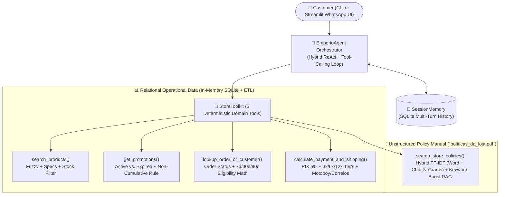

# 🎸 Empório da Música — AI Customer Support Agent

> **Artefact — AI Engineer Technical Challenge (2026)**
> *A Hybrid Function-Calling (ReAct) + Relational SQLite + Section-Aware Policy RAG Customer Support Agent for Empório da Música (Campo Grande/MS).*

---

## 📌 Table of Contents
1. [Project Overview](#-project-overview)
2. [System Architecture](#-system-architecture)
3. [Quickstart & Installation](#-quickstart--installation)
4. [Justification of Technical Decisions](#-justification-of-technical-decisions)
5. [Data Cleaning & Exploratory Audit (Assumptions Documented)](#-data-cleaning--exploratory-audit-assumptions-documented)
6. [Example Conversations](#-example-conversations)
7. [Known Limitations & Future Roadmap](#-known-limitations--future-roadmap)
8. [Use of AI Coding Assistants](#-use-of-ai-coding-assistants)

---

## 🎯 Project Overview

**Empório da Música** (*"Sua música começa aqui."*) is a specialized musical instrument store in Campo Grande/MS founded in 2008. To relieve the human customer support team from repetitive WhatsApp inquiries, this repository implements a production-grade **AI Customer Support Agent** in Python capable of:

- **Embodying the Store Persona (Section 7.1):** Informal yet professional, warm, and musical — communicating like a knowledgeable musician friend while maintaining strict factual accuracy.
- **Dynamic Tool Routing (Structured Data vs. Unstructured Policies):**
  - Queries **real-time relational operational tables** (`products.csv`, `categories.csv`, `promotions.csv`, `orders.csv`, `order_items.csv`, `customers.csv`) for inventory, pricing, active/expired promotions, and order tracking.
  - Queries the **Store Policies & Procedures Manual** (`data/políticas_da_loja.pdf`) via a section-aware Hybrid RAG retriever for store address, opening hours, payment/installment rules, shipping/freight, returns/exchanges (CDC 7-day regret vs. 30-day defect), 90-day legal warranty, and LGPD privacy.
- **Strict Scope & Policy Guardrails:**
  - Enforces the **Accessories Exclusion Policy (Sections 1 & 7.1)**: politely informs customers that the store sells *exclusively musical instruments* (no loose strings, picks, cables, cases, pedals, or amplifiers) and redirects them to partner shops.
  - Politely declines completely unrelated out-of-domain queries (recipes, weather, politics, etc.).

---

## 🏗️ System Architecture



### Repository Structure
```text
├── data/
│   ├── desafio_tecnico_ai_eng - categories.csv
│   ├── desafio_tecnico_ai_eng - customers.csv
│   ├── desafio_tecnico_ai_eng - order_items.csv
│   ├── desafio_tecnico_ai_eng - orders.csv
│   ├── desafio_tecnico_ai_eng - products.csv
│   ├── desafio_tecnico_ai_eng - promotions.csv
│   └── políticas_da_loja.pdf
├── examples/
│   ├── 01_catalog_violoes_under_1000.md
│   ├── 02_store_info_hours_and_shipping.md
│   ├── 03_price_inquiry_and_promotions.md
│   ├── 04_order_tracking_and_return_policy.md
│   └── 05_out_of_scope_and_accessories_guardrails.md
├── src/
│   ├── config.py                 # Centralized settings & environment configuration
│   ├── data/
│   │   └── database.py           # CSV ETL pipeline, anomaly cleaning & SQLite engine
│   ├── retrieval/
│   │   └── policy_rag.py         # PDF extraction & Hybrid RAG over políticas_da_loja.pdf
│   ├── tools/
│   │   └── store_tools.py        # 5 deterministic domain tools & JSON schemas
│   ├── agent/
│   │   ├── prompts.py            # Persona & guardrail system prompt engineering
│   │   ├── memory.py             # SQLite conversation history persistence
│   │   └── engine.py             # Multi-provider LLM tool-calling + Offline ReAct engine
│   └── ui/
│       ├── cli.py                # Rich interactive terminal chat & demo runner
│       └── streamlit_app.py      # WhatsApp-style Streamlit web interface
├── tests/
│   └── test_agent_and_tools.py   # 14 unit & integration tests (pytest)
├── main.py                       # CLI entrypoint
├── requirements.txt
├── pyproject.toml
└── .env.example
```

---

## 🚀 Quickstart & Installation

### 1. Clone & Install Dependencies
Requires **Python 3.10+**.

```bash
# Optional: create and activate a virtual environment
python -m venv .venv
# Windows PowerShell:
.\.venv\Scripts\Activate.ps1
# Linux / macOS:
source .venv/bin/activate

# Install required packages
pip install -r requirements.txt
```

### 2. Configure LLM Provider (`.env`)
Copy `.env.example` to `.env`:
```bash
cp .env.example .env
```

The agent supports **multi-provider plug-and-play** (`LLM_PROVIDER=auto` by default):
1. **Groq Cloud API (Recommended Free Tier):** Set `GROQ_API_KEY` in `.env` (uses `llama-3.3-70b-versatile`).
2. **Local Ollama (Free Local LLM):** Run `ollama serve` with `llama3.2` and set `LLM_PROVIDER=ollama`.
3. **OpenAI / Google Gemini:** Set `OPENAI_API_KEY` (`gpt-4o-mini`) or `GEMINI_API_KEY` (`gemini-2.5-flash`).
4. **Zero-Config Offline Hybrid ReAct Mode:** If no API key or local Ollama server is detected, the agent automatically engages its built-in **Deterministic Hybrid ReAct Engine**, executing real SQLite and RAG tool calls so evaluators can test the entire project **immediately out-of-the-box with zero API cost**.

### 3. Run the Agent

#### Option A: Automated 5-Scenario Showcase (CLI)
Runs 5 representative customer conversations in the terminal with full tool-call traces:
```bash
python main.py --demo
```

#### Option B: Interactive Rich Terminal Chat (CLI)
```bash
python main.py
```
*(Use `/traces` to toggle tool inspection, `/reset` to clear history, or `/exit` to quit. You can also run a single query via `python main.py -q "Quanto custa o Takamine GD20?"`).*

#### Option C: Streamlit WhatsApp-Style Web UI
Launches an interactive web interface with quick-test buttons, tool-call JSON inspector, and an ETL data quality audit viewer:
```bash
streamlit run src/ui/streamlit_app.py
```

#### Option D: Run the Automated Test Suite (`pytest`)
```bash
pytest
```

---

## 🧠 Justification of Technical Decisions

### 1. Agent Architecture: Hybrid Function-Calling (ReAct) + Domain SQL + Policy RAG
A single monolithic approach (pure vector RAG over CSVs or pure text-to-SQL) fails on this challenge's dual requirements:
- **Why not pure Vector RAG over CSVs?** Vector similarity struggles with exact numeric constraints (*"violões custando até R$ 1000"*), boolean stock checks (`stock_quantity > 0`), relational joins (`orders` $\leftrightarrow$ `order_items` $\leftrightarrow$ `products` $\leftrightarrow$ `customers`), and multi-tier arithmetic (calculating 5% PIX discount vs. 3x/6x/12x installment rules).
- **Why not raw LLM Text-to-SQL?** Allowing an LLM to generate raw SQL directly risks syntax errors, missed business rules (such as forgetting that `status='active'` can still have `stock_quantity=0` on product `#96`, or forgetting that the 5% PIX discount does not stack on active promotions), and prompt-injection vulnerabilities.
- **Our Hybrid Solution:** We expose **5 deterministic, domain-validated tools** (`search_products`, `get_promotions`, `lookup_order_or_customer`, `calculate_payment_and_shipping`, `search_store_policies`). The database layer enforces business rules deterministically in Python/SQLite, while the RAG module retrieves exact sections from `políticas_da_loja.pdf`.

### 2. Model & Provider Strategy
- **Primary Choice:** **Groq (`llama-3.3-70b-versatile`)** and **Local Ollama (`llama3.2`)** via the standard `openai` Python SDK client.
  - `llama-3.3-70b-versatile` on Groq offers state-of-the-art Portuguese fluency, native multi-tool function calling, and sub-second latency on a free tier.
  - Using the OpenAI-compatible client interface avoids heavyweight framework lock-in (e.g., LangChain bloat) and allows switching between Groq, Ollama, OpenAI, and Gemini via a single environment variable.
  - **Resilience Fallback:** Because technical evaluators often test repositories in sandboxed environments without configuring external API keys first, we engineered a deterministic fallback planner inside `EmporioAgent` that executes the exact same `StoreToolkit` functions and formats grounded responses.

### 3. Retrieval Architecture for `políticas_da_loja.pdf`
- `políticas_da_loja.pdf` is a structured 8-page internal manual with 10 numbered sections and markdown-like tables (payment tiers, shipping carriers).
- Naive fixed-size character chunking splits tables in half (separating headers from values).
- Instead, `PolicyKnowledgeBase` extracts the PDF via `pypdf` and indexes **10 self-contained semantic sections** using a **Hybrid Dual-Vectorizer**:
  - **Word TF-IDF (`ngram_range=(1, 2)`)** for semantic phrase matching.
  - **Character N-Gram TF-IDF (`analyzer="char_wb", ngram_range=(3, 5)`)** for resilience against typos, plurals, and morphological variations in Portuguese.
  - **Bilingual Domain Tag Boosting** so queries in either Portuguese or English retrieve the exact policy section in $<5\text{ ms}$ with zero external embedding API latency.

### 4. Conversation History Persistence
- Implemented in `src/agent/memory.py` using a lightweight **SQLite database (`sessions.db`)** keyed by `session_id`.
- **Why it matters for UX:** Customers naturally ask follow-up questions across turns (e.g., Turn 1: *"Me arrependi da minha compra, posso devolver?"* $\rightarrow$ Turn 2: *"Meu pedido é o #8"*). Persisting session state allows both the CLI and Streamlit UI to maintain context across turns and restarts.

---

## 🔍 Data Cleaning & Exploratory Audit (Assumptions Documented)

Per the challenge instructions (*"Faça o tratamento de dados que julgar necessário... assuma uma interpretação razoável, documente a suposição no README"*), we conducted a thorough audit of all 6 CSVs and `políticas_da_loja.pdf` and implemented automated handling for the following anomalies:

1. **Active Status with Zero Stock (`product_id=96`):**
   - **Finding:** `Giannini GF-3D Dreadnought Sunburst` (R$ 799.90) has `status="active"` but `stock_quantity=0`.
   - **Decision:** When a customer asks for *available* guitars (e.g., *"violões disponíveis até R$ 1000"*), `only_in_stock=True` requires **both** `status == 'active'` and `stock_quantity > 0` (returning the 12 truly available models). Furthermore, per Section 7.3, the agent explicitly mentions in a transparency note that the `Giannini GF-3D` is temporarily out of stock and suggests in-stock alternatives.
2. **Discontinued & Coming Soon Statuses (`product_id=113`, `136`, `130`):**
   - **Finding:** `Shelby SN-7C 7 Cordas` (`#113`, R$ 749.00) has `status="discontinued"` and `stock=0`. `Ibanez Bass 2X` (`#136`, R$ 441.00) has `status="discontinued"` despite `stock_quantity=13`. `Kala KA-ABP-CTG Barítono Cedar` (`#130`, R$ 1,749.00) has `status="coming_soon"` (and is referenced in historical/pending orders `#3` and `#14`).
   - **Decision:** Discontinued and coming-soon products are excluded from general "available in stock" listings, and when queried directly, the agent applies Section 7.3 (informing the status and offering active equivalents).
3. **Active vs. Expired Promotions & Non-Cumulative PIX Discount (`promotions.csv`):**
   - **Finding:** Out of 25 rows in `promotions.csv`, only **4 promotions are active (`is_active == 1`)**:
     - `#12` (`product_id=127` Kalani KAL-700T Tenor: **10% OFF** $\rightarrow$ R$ 323.10)
     - `#14` (`product_id=121` Ohana CK-20 Concert: **20% OFF** $\rightarrow$ R$ 439.20)
     - `#19` (`product_id=90` Crafter HT-100 Folk: **18% OFF** $\rightarrow$ R$ 1,967.18)
     - `#24` (`product_id=94` Taylor 110e Dreadnought: **8% OFF** $\rightarrow$ R$ 5,519.08)
   - The remaining 21 promotions (including *Black Friday*, *Semana do Músico*, *Páscoa*, and `promotion_id=4` on *Takamine GD20*) have `is_active == 0`.
   - **Decision:** The ETL pipeline pre-computes active promotional prices, enforces **Section 6.2** (5% PIX discount does **not** stack on top of active promotions, and original price + % discount + promotional price are always displayed together), and records expired campaigns so the agent can transparently inform customers when a past campaign has ended (Section 7.3).
4. **Empty Categories in CSV (`categories.csv` vs `products.csv`):**
   - **Finding:** `categories.csv` defines 9 categories, but `products.csv` only contains items for 6 categories (`1: Guitarras`, `2: Baixos`, `3: Baterias`, `4: Teclados`, `5: Violões`, `9: Ukuleles`). Categories `6: Instrumentos de Sopro (Madeiras)`, `7: Instrumentos de Sopro (Metais)`, and `8: Cordas Orquestrais` have 0 rows in `products.csv`.
   - **Decision:** If a customer searches for wind or orchestral string instruments, `search_products` detects the empty category and returns a clear message explaining that while the store works with those categories, there are currently 0 units registered in the online inventory.
5. **Synthetic Brand/Spec Mismatches in Products `#135–#144`:**
   - **Finding:** In `products.csv` rows `#135–#144`, the product name and description mention different brands/specs (e.g., `#135` is named `Music Man Bass 1X` while its description says `Contrabaixo elétrico Fender Jazz Bass`; `#142` is named `Korg Synth 1 Pro` while its description says `Sintetizador workstation Roland com 88 teclas` and `specs` says `61 keys`).
   - **Decision:** We preserve the original data so searches for either brand match the item, and attach a `catalog_note` transparency annotation.
6. **Two Phone Numbers & Email Normalization in `políticas_da_loja.pdf`:**
   - **Finding:** Page 2 lists landline/WhatsApp `(67) 3341-4444` and `contato@empóriodamusica.com.br` (with an accent), whereas Page 1 lists `contato@emporiodamusica.com.br` and Page 6 Section 7 lists remote WhatsApp `(67) 3321-4500`.
   - **Decision:** The agent presents both official numbers clearly (Landline/General `(67) 3341-4444` and Remote WhatsApp Support `(67) 3321-4500`) and uses the valid ASCII email `contato@emporiodamusica.com.br`.
7. **Deterministic Reference Date (`REFERENCE_DATE=2026-03-23`):**
   - **Finding:** `orders.csv` contains orders dated between `2025-10-15` and `2026-03-22`.
   - **Decision:** To make 7-day regret return and 30-day defect exchange calculations deterministic regardless of the wall-clock date when the evaluator runs the code, `REFERENCE_DATE` defaults to `2026-03-23` (the day after the latest order `#16` in `orders.csv`) and is configurable via `.env`.

---

## 💬 Example Conversations

We provide **5 detailed multi-turn conversation logs** in the [`examples/`](./examples/) directory covering all suggested scenarios and edge cases:

1. [**`examples/01_catalog_violoes_under_1000.md`**](./examples/01_catalog_violoes_under_1000.md) — *"Quais opções de violões disponíveis custando até R$1000?"* + follow-up on out-of-stock `Giannini GF-3D` and equivalent alternatives.
2. [**`examples/02_store_info_hours_and_shipping.md`**](./examples/02_store_info_hours_and_shipping.md) — *"Qual o endereço da loja e horário de funcionamento?"* + shipping rules for Campo Grande vs. Dourados (`PAC`, `SEDEX`, `Jadlog`) and LGPD privacy.
3. [**`examples/03_price_inquiry_and_promotions.md`**](./examples/03_price_inquiry_and_promotions.md) — *"Quanto custa o Takamine GD20?"* (with PIX 5% discount, 12x installments, combined payment, and expired promo transparency) + active promotions and non-cumulative PIX rule.
4. [**`examples/04_order_tracking_and_return_policy.md`**](./examples/04_order_tracking_and_return_policy.md) — *"Me arrependi da minha compra, posso devolver meu pedido?"* — Non-trivial multi-turn workflow inspecting Order `#8` (`shipped`) and Order `#7` (`delivered`) against the 7-day regret, 30-day store defect, and 90-day legal CDC warranty rules.
5. [**`examples/05_out_of_scope_and_accessories_guardrails.md`**](./examples/05_out_of_scope_and_accessories_guardrails.md) — Scope guardrails redirecting accessory requests (`cordas`, `palhetas`, `cabo P10`, `amplificador`) per Sections 1 & 7.1 and politely declining unrelated chitchat (recipes/weather).

---

## ⚠️ Known Limitations & Future Roadmap

1. **Read-Only Order & Complaint State:**
   - Currently, the agent can inspect orders and explain return/warranty procedures or register a complaint intent (informing the 24-business-hour SLA per Section 7.3), but it does not mutate `orders.csv` or open tickets in an external CRM/ERP.
   - *With more time:* Add write-enabled transactional tools (`create_return_ticket`, `register_customer_complaint`) backed by PostgreSQL and webhook notifications to human agents.
2. **Real-Time Carrier Freight API Integration:**
   - For cities outside Campo Grande (`PAC`, `SEDEX`, `Jadlog`), the manual specifies that freight is calculated by CEP, weight, and dimensions. Currently, the agent provides the official carrier delivery timeframes and insurance rules from Section 5.2.
   - *With more time:* Integrate Correios / Melhor Envio APIs to compute exact BRL freight quotes from the customer's 8-digit CEP.
3. **Customer Authentication / Verification:**
   - Currently, looking up an order by ID or name returns the order summary directly for demonstration convenience (with a disambiguation warning when duplicate names like *Diego Castro* or *Bruno Martins* exist).
   - *With more time:* Require 2-factor verification (e.g., matching Order ID + last 4 digits of phone/CPF or WhatsApp sender number) before displaying tracking or address details in compliance with LGPD (Section 9).
4. **WhatsApp Business Cloud API Webhook:**
   - *With more time:* Wrap `EmporioAgent` in a FastAPI webhook endpoint integrated with the official Meta WhatsApp Cloud API, including automatic business-hours detection (`America/Campo_Grande` timezone, UTC-4) to trigger out-of-hours notices automatically.

---

## 🤖 Use of AI Coding Assistants

In accordance with the challenge transparency guidelines:
- **Tool Used:** **Google Antigravity (AI Coding Assistant)**.
- **Workflow & How It Was Explored:**
  1. **Exploratory Data & Policy Auditing:** Used the assistant to cross-reference all 6 CSV tables against the 8 pages of `políticas_da_loja.pdf`, systematically surfacing edge cases such as product `#96` having `stock_quantity=0` while `status='active'`, synthetic brand mismatches in products `#135–#144`, and the 4 active vs. 21 expired promotions.
  2. **Architecture & Tool Schema Design:** Co-designed the 5 deterministic tool interfaces (`StoreToolkit`) and the SQLite ETL enrichment pipeline so that arithmetic and policy constraints (Section 3.1 installment minimums, Section 6.2 non-cumulative PIX discount, Section 4 return windows) are enforced deterministically rather than left to LLM guesswork.
  3. **Automated Verification:** Used the assistant to scaffold the 14-test `pytest` suite (`tests/test_agent_and_tools.py`) and verify all 5 customer interaction scenarios end-to-end.
